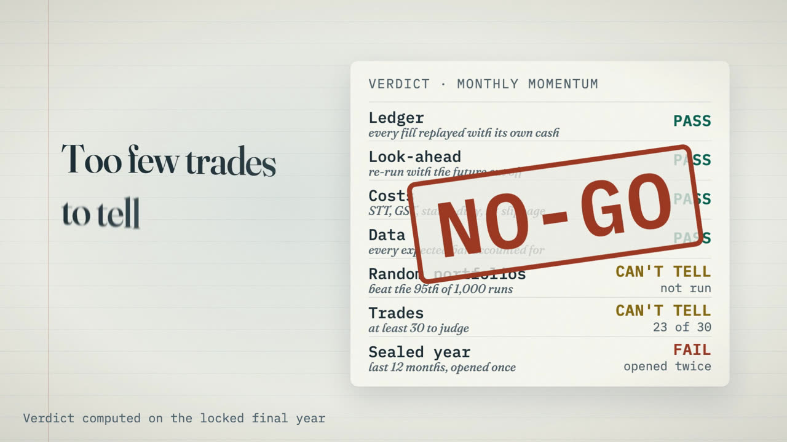

# Demo video

[](oracle-autopsy-demo.mp4)

[oracle-autopsy-demo.mp4](oracle-autopsy-demo.mp4) (50 s, 720p, silent) shows the
whole tool in one story:

1. The old bot's balance grows from ₹10,000 to ₹1,60,000 on a flat market.
   The independent ledger stays at ₹10,000: the money was invented.
2. The checks the tool now runs before it will say GO.
3. Monthly momentum on the sealed final year (6 Nov 2025 to 5 Nov 2026):
   +₹88,572 (+44%) against the Nifty 50's −₹8,258. That beat 99.9% of 1,000
   random portfolios, checked after the verdict.
4. It is still NO-GO: 23 trades, where 30 are needed, and the sealed year was
   opened twice. Paper trading only.

Every number comes from the repo's own reports (`autopsy case oracle` and the
monthly-momentum verdict). None was made up for the video.

## How it is made

The video is one HTML page,
[oracle-autopsy-demo.html](oracle-autopsy-demo.html). Open it in a browser and it
plays and loops; add `?debug=1` for a scrub bar. Everything moves from one GSAP
timeline, with no clock or randomness, so every render is identical.
[style-brief.md](style-brief.md) records the design decisions and the shot list.

It follows two open-source Claude skills, both MIT-licensed:

- [Bang Motion](https://github.com/bangtutorial/bang-motion): a camera that moves
  through one world instead of slides, the text animations, and the
  frame-by-frame export.
- [huashu-art-motion](https://github.com/alchaincyf/huashu-art-motion), finance-chart
  grammar: axes first, data grows over time, one thing marked per shot, source on
  screen. Its stroke-by-stroke drawing appears here as the pen that draws every line.

To render the MP4 again (you need Node, ffmpeg and a Chromium binary):

```sh
cd docs/demo/tools && npm i playwright-core
CHROME=/path/to/chromium node export.mjs ../oracle-autopsy-demo.html ../demo-1080p.mp4
```

It is paper-trading research, not investment advice.
